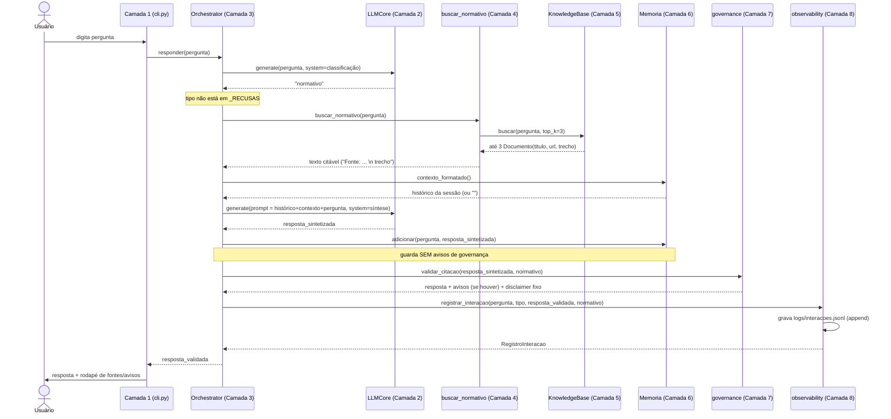
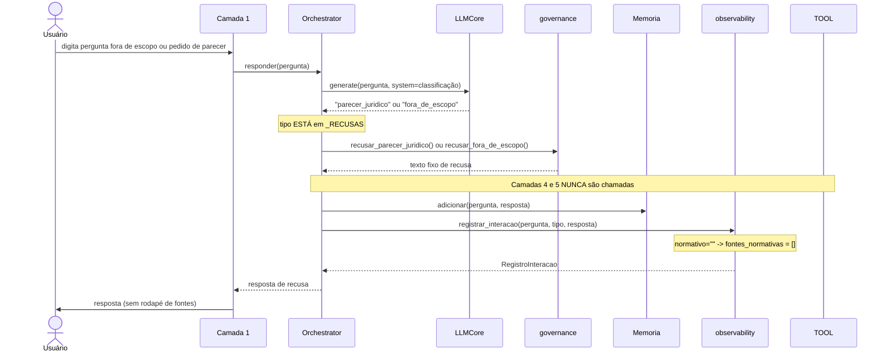

# Fluxo de Execução

> **Retrato histórico (2026-09-23, v1).** Esta análise descreve o código da v1 e não reflete as mudanças da v2 em diante (Gold e BM25, Camada 7 v2, v4 a v7). Para o estado atual, ver `docs/estado_atual.md`.

Este documento traça, como um debugger faria, o que acontece do momento em
que se digita `python main.py` até o encerramento do processo, incluindo o
que acontece a cada pergunta feita.

## 1. Momento do import — o que acontece antes de qualquer linha de `main()` rodar

Quando o interpretador processa `import` em cascata a partir de `main.py`,
código de nível de módulo roda imediatamente, antes de `main()` ser chamado:

1. **`main.py:7`** importa `main` de `src.layer1_interaction.cli`.
2. Isso dispara **`src/layer1_interaction/cli.py:17`**, que importa
   `Orchestrator` de `src.layer3_orchestration.orchestrator`.
3. Isso dispara **`src/layer3_orchestration/orchestrator.py:22-30`**, que
   importa `LLMCore`, `buscar_normativo`, `Memoria`,
   `recusar_fora_de_escopo`/`recusar_parecer_juridico`/`validar_citacao`, e
   `RegistroInteracao`/`registrar_interacao`.
4. `buscar_normativo` vem de **`src/layer4_tools/tools.py`**, cujo corpo de
   módulo executa **`_kb = KnowledgeBase()`** na linha 17 — **efeito colateral
   de import**: isso já dispara `KnowledgeBase.__init__` →
   `self._carregar()` (`src/layer5_knowledge/knowledge_base.py:78-94`), que
   **lê todos os arquivos `.md` de `data/normativos/` do disco e os indexa
   em memória**, antes mesmo de `main()` começar a rodar. Se o diretório não
   existir ou os arquivos estiverem malformados, a exceção propaga no import,
   travando o programa antes de qualquer interação com o usuário.
5. `LLMCore` vem de **`src/layer2_llm_core/core.py`**, que importa `settings`
   de **`src/config.py`**. `src/config.py:15` chama `load_dotenv()` no nível
   de módulo — lê o arquivo `.env` do diretório de trabalho e popula
   variáveis de ambiente do processo. A linha seguinte
   (`src/config.py:18-24`) instancia `Settings()` uma única vez, um
   singleton de fato (`settings`) compartilhado por todo o processo.

**[FATO]** O corpus normativo é carregado **uma única vez por processo**, no
import (não a cada pergunta) — `_kb` em `tools.py:17` é uma variável de
módulo, não recriada em `buscar_normativo()`. Isso significa que, se um
arquivo `.md` do corpus mudar em disco enquanto o programa está rodando, a
mudança não é vista até reiniciar o processo.

## 2. Inicialização de `main()` (Camada 1)

**`src/layer1_interaction/cli.py:34-38`**:

1. Imprime o cabeçalho de boas-vindas e a lista de comandos de saída
   (`sair`/`exit`/`quit`, definidos em `COMANDOS_SAIDA` — `cli.py:19`).
2. Instancia **um único `Orchestrator()`** (`cli.py:38`) — decisão de projeto
   explícita e documentada (`docs/decisoes_arquitetura.md:49-52`): um
   `Orchestrator` por *sessão*, não por *pergunta*, para que a Camada 6
   (memória) acumule o histórico da conversa inteira.
3. `Orchestrator.__init__` (`orchestrator.py:49-56`) por sua vez instancia
   `LLMCore()` e `Memoria()` próprios (a menos que injetados — ver
   `05_decisoes_de_design.md` sobre por que os parâmetros são opcionais) e
   inicializa `self.ultimo_registro = None`.

## 3. Loop de conversa (Camada 1)

**`src/layer1_interaction/cli.py:40-58`**, um `while True:`:

1. `input("> ")` bloqueia esperando o usuário digitar. `EOFError` ou
   `KeyboardInterrupt` (Ctrl+D/Ctrl+C) são capturados e encerram o loop com
   uma mensagem (`cli.py:41-45`) — saída limpa, não um stack trace.
2. Pergunta vazia (após `.strip()`) é ignorada, volta ao topo do loop
   (`cli.py:47-48`).
3. Se a pergunta bater com um comando de saída (case-insensitive), encerra
   (`cli.py:49-51`).
4. Caso contrário, chama `orchestrator.responder(pergunta)` — é aqui que
   toda a lógica das Camadas 2-8 acontece (detalhado na Seção 4 abaixo).
5. Imprime a resposta, depois um rodapé de proveniência montado por
   `_formatar_proveniencia(orchestrator.ultimo_registro)` (`cli.py:22-31`):
   lista os títulos das fontes normativas usadas e, se houve aviso de
   citação não verificada, uma linha de alerta adicional.
6. Volta ao topo do loop — o processo nunca termina sozinho, só por
   EOF/Ctrl+C/comando de saída.

## 4. `Orchestrator.responder(pergunta)` — o núcleo do fluxo (Camada 3)

**`src/layer3_orchestration/orchestrator.py:58-79`**. Duas ramificações
possíveis:

### 4a. Ramo de recusa (`parecer_juridico` ou `fora_de_escopo`)

1. `self._interpretar(pergunta)` (`orchestrator.py:81-93`) monta um prompt de
   sistema que instrui o LLM a responder com **apenas uma palavra**:
   `normativo`, `parecer_juridico` ou `fora_de_escopo`
   (`orchestrator.py:82-89`), chama `self.llm.generate(...)` (uma chamada de
   rede a `ollama.chat`, Camada 2), normaliza (`strip().lower()`) e, se a
   resposta não for uma das 3 palavras esperadas, aplica um **fallback
   conservador**: assume `"normativo"` (`orchestrator.py:91-92`).
2. Se `interpretacao.tipo` está no dicionário `_RECUSAS`
   (`orchestrator.py:36-39`, mapeando `"parecer_juridico"` →
   `recusar_parecer_juridico` e `"fora_de_escopo"` → `recusar_fora_de_escopo`,
   ambas da Camada 7), a função de recusa é chamada — **retorna um texto
   fixo, sem nenhuma chamada adicional ao LLM, sem busca normativa**.
3. `self.memoria.adicionar(pergunta, resposta)` grava o par no histórico
   (Camada 6).
4. `registrar_interacao(pergunta, interpretacao.tipo, resposta)` (Camada 8)
   grava um log estruturado em `logs/interacoes.jsonl` e retorna o
   `RegistroInteracao`, guardado em `self.ultimo_registro`.
5. Retorna a resposta de recusa. **Fim — nenhuma das Camadas 4, 5 rodou.**

### 4b. Ramo normativo

1. `self._buscar_normativo(interpretacao)` (`orchestrator.py:95-96`) chama
   `buscar_normativo(pergunta_original)` da Camada 4
   (`src/layer4_tools/tools.py:20-34`), que por sua vez chama
   `_kb.buscar(pergunta, top_k=3)` da Camada 5
   (`knowledge_base.py:96-105`): tokeniza a pergunta (minúsculas, sem
   acento, sem stopwords, palavras >2 caracteres —
   `knowledge_base.py:37-45`), pontua cada trecho indexado por interseção de
   conjuntos de tokens, ordena decrescente e retorna os 3 melhores. A
   Camada 4 formata o resultado como texto citável: `"Fonte: {titulo}
   ({url})\n{trecho}"`, blocos separados por `"\n\n---\n\n"`
   (`tools.py:31-34`). Se nada bateu, retorna uma string fixa dizendo que
   nada foi encontrado (`tools.py:28-29`).
2. `self._sintetizar_resposta(pergunta, normativo)`
   (`orchestrator.py:98-112`) monta um prompt de sistema instruindo o LLM a
   agir como copiloto de compliance e nunca dar parecer definitivo
   (`orchestrator.py:99-104`), injeta o **histórico formatado da Camada 6**
   (`self.memoria.contexto_formatado()`) se houver, depois o contexto
   normativo, depois a pergunta — e chama `self.llm.generate(...)` (segunda
   chamada de rede ao LLM nesta ramificação, com prompt maior e saída mais
   longa que a de classificação).
3. **Ponto crítico de ordem**: `self.memoria.adicionar(pergunta,
   resposta_sintetizada)` (`orchestrator.py:74`) grava no histórico a
   resposta **antes** da validação de citação — deliberado, para não deixar
   o disclaimer de governança entrar no histórico e ser ecoado pelo modelo
   em turnos seguintes (bug real encontrado e documentado, ver
   `05_decisoes_de_design.md`).
4. `self._validar_citacao(resposta_sintetizada, normativo)`
   (`orchestrator.py:114-115`) chama `validar_citacao` da Camada 7
   (`governance.py:60-93`): extrai por regex todo número de artigo e
   nome/número de norma citados na resposta e no contexto normativo, calcula
   a diferença de conjuntos, anexa um aviso textual para cada citação que
   não aparece no contexto, e sempre anexa o disclaimer fixo de validação
   humana ao final.
5. `registrar_interacao(pergunta, interpretacao.tipo, resposta_validada,
   normativo)` (Camada 8) grava o log — desta vez com `normativo` não-vazio,
   então `_extrair_fontes` (`observability.py:41-53`) usa regex para achar
   todas as linhas `"Fonte: título (url)"` no texto do contexto normativo e
   deduplica por `(titulo, url)`.
6. Retorna `resposta_validada` (a resposta **com** avisos/disclaimer) ao
   chamador — mas a memória guarda a versão **sem** avisos (passo 3).

## 5. Encerramento

Não há flush/fechamento explícito de recursos: `registrar_interacao` abre e
fecha o arquivo de log a cada chamada (`with destino.open("a", ...)
as f:` — `observability.py:73-74`), não mantém um file handle aberto entre
interações. `KnowledgeBase` mantém tudo em memória (lista Python), sem
conexão de banco/arquivo persistente para fechar. O processo termina quando
o loop da Camada 1 quebra (EOF, Ctrl+C, ou comando de saída) — não há
`atexit`, `finally` de nível superior, nem cleanup adicional.

## Diagrama de sequência — uma pergunta do tipo `normativo`

## Diagrama de sequência — pergunta recusada (`parecer_juridico`/`fora_de_escopo`)

## Ramificações — tabela de decisão

| Condição | Caminho | Camadas envolvidas | Chamadas ao LLM |
|---|---|---|---|
| `_interpretar` retorna algo fora de `{normativo, parecer_juridico, fora_de_escopo}` | Tratado como `"normativo"` (fallback conservador, `orchestrator.py:91-92`) | Segue o ramo normativo | 2 |
| `tipo == "parecer_juridico"` | Recusa fixa | 3, 6, 7 (recusa), 8 | 1 |
| `tipo == "fora_de_escopo"` | Recusa fixa | 3, 6, 7 (recusa), 8 | 1 |
| `tipo == "normativo"` | Busca + síntese + validação | 2, 3, 4, 5, 6, 7, 8 | 2 |
| `KnowledgeBase.buscar` não encontra nenhum trecho com interseção de tokens > 0 | Retorna lista vazia → `tools.py:28-29` retorna string fixa "nenhum trecho relevante" como se fosse o contexto | Segue normalmente — o LLM sintetiza sem contexto real | 2 |

## Caminhos de erro

**[FATO]** Não há bloco `try/except` em nenhum dos módulos de `src/layer1`
a `layer8` (confirmado por leitura completa de todos eles) — a única captura
de exceção do sistema é em `cli.py:41-45`, especificamente para
`EOFError`/`KeyboardInterrupt` no `input()`. Isso significa que:

- Se o Ollama não estiver rodando, `ollama.chat(...)` em `core.py:35`
  levanta uma exceção de conexão que **não é capturada em nenhum lugar** —
  propaga até o topo e derruba o processo com um traceback bruto, no meio de
  uma pergunta do usuário.
- Se `data/normativos/` não existir no import (Seção 1 acima), o processo
  nem chega a imprimir o cabeçalho de boas-vindas.
- `run_check_memory.py`, `run_check_governance.py` e
  `run_check_observability.py` usam `assert` para validar comportamento —
  uma falha ali interrompe o script com `AssertionError`, sem tratamento
  especial (comportamento correto para um script de validação manual, ver
  `06_testes_config_operacao.md`).

Ver `07_riscos.md` para a avaliação de até que ponto essa ausência de
tratamento de erro é um problema real dado o propósito do sistema.
