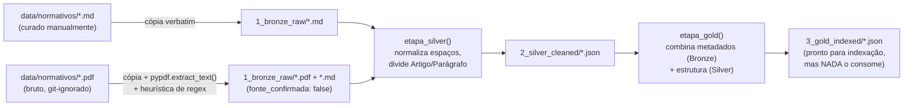

# Dados e Estado

## Estruturas de dados centrais

| Estrutura | Definida em | Campos | Papel |
|---|---|---|---|
| `Settings` (`@dataclass`) | `config.py:18-21` | `ollama_model`, `ollama_host` | Config transversal, singleton `settings` |
| `Interpretacao` (`@dataclass`) | `orchestrator.py:42-45` | `pergunta_original`, `tipo` | Resultado da classificação de intenção (Camada 3) |
| `Documento` (`@dataclass`) | `knowledge_base.py:29-34` | `titulo`, `ementa`, `url_oficial`, `trecho` | Um trecho (artigo) indexado do corpus normativo |
| `Interacao` (`@dataclass`) | `memory.py:15-18` | `pergunta`, `resposta` | Um par pergunta/resposta na memória de sessão |
| `RegistroInteracao` (`@dataclass`) | `observability.py:31-38` | `timestamp`, `pergunta`, `tipo_classificacao`, `fontes_normativas`, `aviso_citacao_nao_verificada`, `resposta_final` | Registro de proveniência de uma interação, persistido em log |
| `Paragrafo` / `Artigo` (`@dataclass`) | `ingest_normativos.py:108-118` | `identificador`, `texto` (+`paragrafos` para `Artigo`) | Unidades estruturadas do pipeline ilustrativo Bronze/Silver/Gold |

Todas as estruturas de dados do projeto são `@dataclass` simples — não há
`pydantic`, `attrs`, nem classes com lógica de validação complexa. Coerente
com o princípio geral do projeto de evitar dependências/abstrações sem
necessidade concreta (ver `05_decisoes_de_design.md`).

## Formato de arquivo do corpus normativo (`data/normativos/*.md`)

Markdown com frontmatter delimitado por `---`, parseado por
`_parse_frontmatter` (implementado de forma idêntica, mas independente, em
`knowledge_base.py:48-62` e `ingest_normativos.py:121-135`):

```
---
titulo: "Resolução Conjunta nº 1, de 4 de maio de 2020"
orgao: "Banco Central do Brasil (BCB) / Conselho Monetário Nacional (CMN)"
ementa: "Dispõe sobre a implementação do Open Finance."
data_publicacao: "2020-05-04"
url_oficial: "https://normativos.bcb.gov.br/..."
versao: "consolidada (v7), obtida em 2026-08-14"
---

<texto integral do normativo, começando pelo título e "Art. 1º...">
```
(confirmado lendo `data/normativos/resolucao_conjunta_1_2020.md:1-8`)

## Fluxo de transformação dos dados — corpus normativo (caminho real, runtime)

```mermaid
flowchart LR
    A["PDF oficial do BCB\n(baixado manualmente)"] -->|"extração manual\n(fora do repositório)"| B["data/normativos/*.md\n(frontmatter + texto integral)"]
    B -->|"KnowledgeBase._carregar()\nglob não-recursivo"| C["lista de Documento\n(1 por artigo, em memória)"]
    C -->|"buscar(pergunta)\nsobreposição de tokens"| D["até 3 Documento\nmais relevantes"]
    D -->|"buscar_normativo()\nformata em texto citável"| E["contexto normativo\n(string, 'Fonte: ... \\n trecho')"]
    E -->|"_sintetizar_resposta()\nprompt ao LLM"| F["resposta sintetizada"]
    F -->|"validar_citacao()\nregex vs. contexto"| G["resposta final\n+ avisos + disclaimer"]
    G -->|"registrar_interacao()"| H["logs/interacoes.jsonl\n(JSON Lines, append)"]
```



## Fluxo de transformação dos dados — pipeline ilustrativo (paralelo, NÃO runtime)



**[FATO]** Este segundo fluxo termina em um beco sem saída por desenho: o
JSON gerado em `3_gold_indexed/` não é lido por `KnowledgeBase` nem por
nenhum outro módulo — existe só como demonstração de como uma arquitetura
medalhão *poderia* organizar a ingestão, sem estar de fato ligada ao sistema
(`docs/decisoes_arquitetura.md:472-509`).

## Onde o estado vive

| Estado | Onde | Escopo de vida | Quem altera |
|---|---|---|---|
| Corpus indexado (`KnowledgeBase.documentos`) | Memória do processo (lista Python) | Todo o processo, carregado uma vez no import de `layer4_tools/tools.py` | Ninguém depois do carregamento inicial — `KnowledgeBase` não expõe método de escrita |
| Histórico de sessão (`Memoria._interacoes`) | Memória do processo, dentro do `Orchestrator` | Uma sessão de `main.py` (ou uma chamada isolada de script) | `Orchestrator.responder()`, via `self.memoria.adicionar(...)` |
| Config (`settings`) | Memória do processo, calculado uma vez no import de `config.py` | Todo o processo | Ninguém em runtime — só recarregando o processo com `.env` diferente |
| Log de proveniência (`logs/interacoes.jsonl`) | Disco, append-only | Persiste entre execuções (até ser apagado manualmente — git-ignorado) | `registrar_interacao()`, uma escrita por interação |
| Resultados de benchmark | Disco (`logs/resultados_benchmark.json`, `docs/tabela_resultados_empiricos.csv`) | Persiste entre execuções (o CSV é versionado no git) | `run_benchmark.py`, sobrescreve o arquivo inteiro a cada execução (não é append) |
| Corpus curado (`data/normativos/*.md`) | Disco, versionado no git | Permanente, editado manualmente pelo pesquisador | Ninguém programaticamente — nenhum script do projeto escreve nesses arquivos específicos (confirmado: `ingest_normativos.py` só lê deles, nunca escreve) |

## Concorrência

**[FATO]** Não há threads, `asyncio`, `multiprocessing`, filas nem locks em
nenhum lugar do código-fonte do projeto (`src/`, scripts) — confirmado por
leitura completa de todos os arquivos. O sistema é inteiramente síncrono e
de processo único. `httpx`/`anyio`/`h11` aparecem no `venv/` só como
dependências transitivas do cliente HTTP usado internamente pela biblioteca
`ollama` para falar com o servidor local — não são usados diretamente pelo
código do projeto.

**[INFERÊNCIA]** Isso significa que `python run_benchmark.py` (20 execuções
sequenciais, cada uma ~11s no caminho normativo) é inerentemente serial —
não há paralelismo para acelerar a coleta de dados do benchmark. Para um
protótipo de pesquisa com escopo de avaliação pequeno (20 execuções), isso é
aceitável; seria uma limitação real para um volume de avaliação muito maior.

## Risco de concorrência entre processos (não entre threads)

**[INFERÊNCIA — não testado no código]**: `registrar_interacao` abre o
arquivo de log em modo append (`"a"`) e escreve uma linha por vez
(`observability.py:73-74`), sem lock de arquivo. Se dois processos
`python main.py` rodassem simultaneamente escrevendo no mesmo
`logs/interacoes.jsonl`, há risco teórico de intercalação de escritas
(cada `write()` de uma linha JSON pequena tende a ser atômica no SO na
prática, mas isso não é uma garantia formal do código). Não encontrei
evidência de que múltiplas instâncias simultâneas sejam um cenário de uso
previsto ou testado — o sistema é desenhado para uso interativo de um único
usuário por vez.
